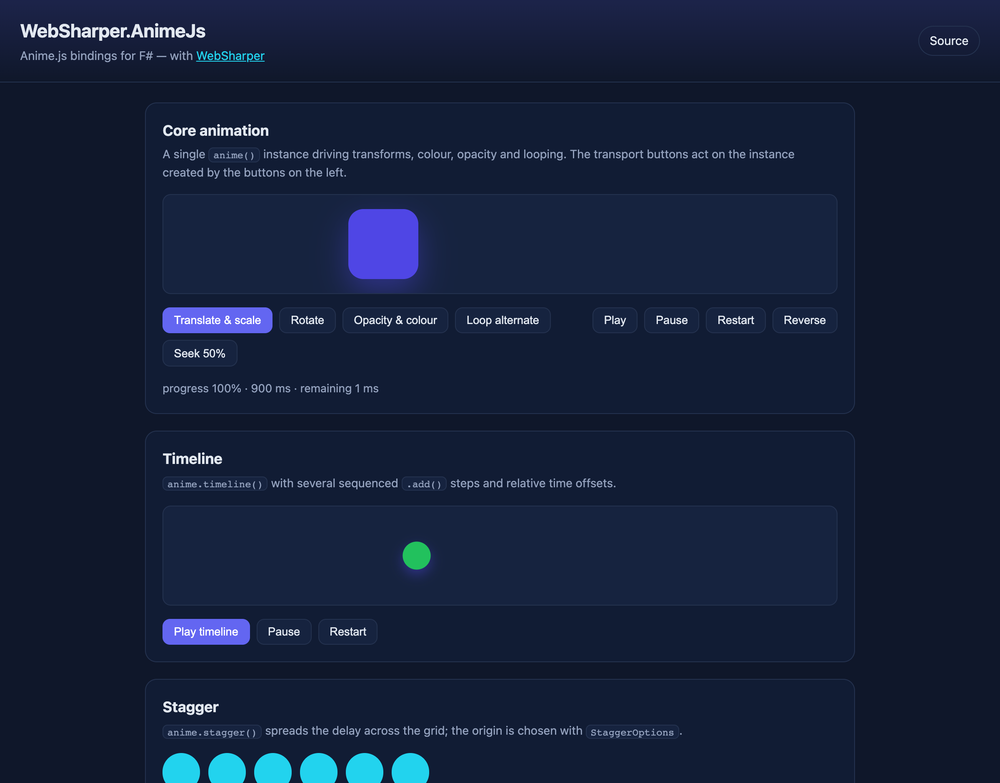

# WebSharper.AnimeJS

[](https://www.nuget.org/packages/WebSharper.AnimeJs)

WebSharper bindings for [anime.js](https://animejs.com/) 3.2.x — the lightweight
JavaScript animation engine — for F# and C# web apps.

The binding consumes the npm package [`animejs`](https://www.npmjs.com/package/animejs)
as an ES module (`import anime from "animejs/lib/anime.es.js"`) and is bundled by
your toolchain (esbuild in the sample); there is no CDN `<script>` tag.

This repository contains:

| Project | Purpose |
| --- | --- |
| `WebSharper.AnimeJs` | The binding: WIG definitions for `Anime`, `Timeline`, `Animation`, `Animatable`, `Tween`, `AnimeParams`, `TimelineParams`, `StaggerOptions`, `Easing`, `PathValues`, `PathTarget` and friends. |
| `WebSharper.AnimeJs.Sample` | A WebSharper SPA (esbuild → `dist/`) that drives the whole surface: core animations, a timeline, `stagger`, SVG-path morphing and the `anime.*` helpers. |

## Live demos

**Try it live:** [Open the sample in your browser](https://dotnet-websharper.github.io/animejs/)



The sample doubles as the binding's [test case](#running-the-test-case): it
creates animations, a timeline, a staggered grid, morphs an SVG path with
`PathValues`/`anime.path` and exercises the `anime.*` helpers (`random`, `get`,
`set`, `remove`, `running`, `version` and `suspendWhenDocumentHidden`).

- **Sample (this repository):** <https://dotnet-websharper.github.io/animejs/>
- **Source repository:** <https://github.com/dotnet-websharper/animejs>
- **WebSharper bindings:** <https://websharper.com/bindings>

## Install

```bash
dotnet add package WebSharper.AnimeJs
```

Or with Paket:

```fsharp
nuget WebSharper.AnimeJs
```

The package targets `netstandard2.0` and works with any WebSharper 10 or 11
project. anime.js itself is pulled from npm (`animejs`), so the JS bundle step
must resolve it (WebSharper's SPA/esbuild build does this automatically).

## Usage

All types live in the `WebSharper.AnimeJs` namespace.

### Animate an element

```fsharp
open WebSharper
open WebSharper.JavaScript
open WebSharper.AnimeJs

[<JavaScript>]
let AnimateBox (box: Dom.Element) =
    Anime(
        AnimeParams(
            box,
            TranslateX = (0., 220.),
            Scale = (1., 1.5),
            Opacity = (1., 0.35),
            Background_color = ("#4f46e5", "#f59e0b"),
            Duration = 900,
            Direction = Direction.Alternate,
            Loop = 2,
            Easing = Easing.Cubic(0.5, 0.05, 0.1, 0.3),
            Update = (fun anim -> Console.Log anim.Progress)
        )
    )
    |> ignore
```

`Anime(...)` returns an `Anime` instance with the full `AnimeInstance` surface:
`Play()`, `Pause()`, `Restart()`, `Reverse()`, `Seek(ms)`, `Tick(ms)`, and the
`Progress`, `CurrentTime`, `Duration`, `Remaining`, `Paused`, `Completed`,
`Began`, `Reversed`, `Direction`, `Loop` and `Finished` members.

Property keys follow anime.js's JS names. **Kebab-case CSS properties become
underscored in .NET** (`background-color` → `Background_color`,
`z-index` → `Z_index`), while camel-cased properties keep their casing
(`translateX` → `TranslateX`, `endDelay` → `EndDelay`).

### Timelines

```fsharp
let timeline (box: Dom.Element) =
    Anime.Timeline(TimelineParams(Targets = box, Duration = 800, Easing = Easing.EaseInOutQuad))
        .Add(TimelineParams(TranslateX = (0., 260.), Rotate = (0., 360.), Duration = 900), "+=200")
        .Add(TimelineParams(Opacity = (1., 0.3), Duration = 400, Loop = 2))
        .Play()
```

### Stagger

```fsharp
Anime(AnimeParams(
    items,
    Delay = Anime.Stagger(60, StaggerOptions(Grid = (6, 4), From = FromValue.Center)),
    Scale = (0.35, 1.),
    Duration = 700,
    Easing = Easing.Elastic(ElasticEasingType.EaseOutElastic, 1., 0.6)
)) |> ignore
```

### SVG paths

```fsharp
Anime(AnimeParams(path, D = PathValues("M100,10 C190,10 190,110 100,110 Z"), Duration = 800))
    |> ignore

let point = Anime.Path("#morph-path").Invoke(PathOptions.X)
Console.Log point.Property point.TotalLength
```

### The `anime.*` helpers

`Anime.Version`, `Anime.Speed`, `Anime.Running`, `Anime.Remove(targets)`,
`Anime.Get(targets, property)`, `Anime.Set(targets, values)`,
`Anime.SetDashoffset(el)`, `Anime.Random(min, max)` and
`Anime.SuspendWhenDocumentHidden`.

## Notes on the API

- **The package is npm-based.** `Anime` is ES-imported from
  `animejs/lib/anime.es.js`; nothing is fetched from a CDN. Add `animejs` to your
  front-end dependencies (WebSharper registers it as an `NpmDependencies` entry).
- **`Anime` is the default export, used both as a function and as a namespace.**
  The constructor form maps to `anime(params)` and the statics map to
  `anime.timeline`, `anime.stagger`, `anime.get`, and so on.
- **Callbacks receive the `Anime` instance.** The `Begin`/`Update`/`Complete`/
  `LoopBegin`/`LoopComplete`/`ChangeBegin`/`ChangeComplete`/`Change` callbacks
  are typed as `Anime -> unit`, so you can call `Pause()` or read `Progress`
  directly.
- **Function-typed members are `Func<...>`.** WIG maps `a ^-> b` to
  `System.Func<a, b>`, so the value returned by `Anime.Path(...)` is invoked with
  `.Invoke(...)`.
- **`Easing.Cubic`/`Spring`/`Elastic`/`Step` are string builders.** They return
  the easing string anime.js understands (`"cubicBezier(...)"`, `"spring(...)"`,
  …). The named easings (`Easing.EaseOutCirc`, `Easing.Linear`, …) are plain
  values, and the elastic family is `ElasticEasingType` (e.g.
  `Easing.Elastic(ElasticEasingType.EaseOutElastic, 1., 0.6)`).
- **The optional parameters are a single config object.** `AnimeParams` requires
  `targets` (passed positionally); everything else is a named optional argument.

## Running the test case

The sample is a static SPA. Building it runs `npm install` and esbuild and emits
`dist/` at the repository root:

```bash
dotnet build WebSharper.AnimeJs.Sample/WebSharper.AnimeJs.Sample.fsproj -c Release
python3 -m http.server -d dist 8080
```

Open <http://localhost:8080/>. anime.js is fully bundled, so no network access
is needed. The buttons drive the whole binding — use them to verify a change end
to end.

## Building from source

### Prerequisites

- [.NET SDK 10](https://dotnet.microsoft.com/download) or later.
- [Node.js](https://nodejs.org/) (for the sample's esbuild step).
- [Paket](https://fsprojects.github.io/Paket/) as a local dotnet tool (configured
  in `.config/dotnet-tools.json`).

### Restore and build

```bash
dotnet tool restore
dotnet paket restore
dotnet build WebSharper.AnimeJs.sln -c Release
```

The binding targets `netstandard2.0`; the sample is a static bundle.

### Pack the NuGet package

After a Release build (so the assembly exists in `bin/Release/netstandard2.0`):

```bash
dotnet paket pack ./out
```

## Deployment

Pushing to the default branch triggers `.github/workflows/ghpages.yml`, which
builds the sample in Release and publishes `dist/` to the `gh-pages` branch via
GitHub Pages.

## Repository layout

```
WebSharper.AnimeJs/              # the binding (WIG definitions)
  Main.fs
WebSharper.AnimeJs.Sample/       # static SPA demo / test case
  Client.fs
  index.html
  site.css
  esbuild.config.mjs
  wsconfig.json
docs/
  sample.png                     # screenshot of the running sample
nuget/                           # Paket pack template
.github/workflows/ghpages.yml    # build + deploy the sample
```

## License

Apache 2.0 — see [LICENSE.md](LICENSE.md).
